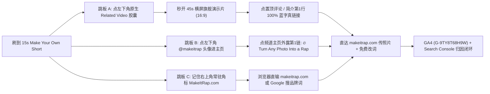

# Make Your Own Shorts 栏目生产与 MakeItRap.com 网站引流作战计划

> [!IMPORTANT]
> **立项背景与核心破局点（基于 `@makeitrap` 频道后台与 GA4 `G-9TY8T68H9W` 实测诊断）**：
> 1. **为什么过去 7 天 YouTube → `makeitrap.com` 引流为 `0`？** YouTube 已永久禁用 Shorts 简介与 Shorts 评论区的所有超链接点击（移动端仅显示为不可点击的纯文本），且新频道在达到 YPP 门槛前无法挂载片尾外链卡片；同时，把“吃瓜看历史/游戏人物对决”的娱乐心智与“上传真人照片做恶搞说唱”的工具转化心智混在同一条视频里，导致双头落空。
> 2. **破局总纲**：将 Shorts 彻底拆分为**双轨独立漏斗**——`Battle Shorts V2` 专职喂算法涨粉并导流完整对决正片；全新启动 [频道方案.md](file:///Volumes/WorkData/Workspace/projects/colab-ultra-workstation/workflows/05_ancient_rap_battle/channel/频道方案.md) 规划的 **`Make Your Own Shorts` 产品实机爽片栏目**，通过 **「45 秒置顶横屏旗舰演示片桥接 + `@makeitrap` 主页首链 + `MakeItRap.com` 12 字母视觉锤」三路跳板架构**，在 **零 Colab 算力消耗（`0 CCU`）** 的前提下直接打通注册、免费改词与付费生成转化闭环。

---

## 1. 双轨漏斗分工与每周排期配比

### 1.1 双轨内容定位与职责边界

在同一频道 `@makeitrap` 下，娱乐 IP 内容与工具带货内容服务于完全不同的用户微时刻（Micro-moment），必须严格划清创作与导流边界：

| 维度 | 轨道 A：`Battle Shorts V2`（IP 涨粉轨） | 轨道 B：`Make Your Own Shorts`（产品转化轨） | 桥接锚点：`45s 横屏旗舰演示片`（转化跳板） |
| :--- | :--- | :--- | :--- |
| **视频规格** | `9:16` 竖屏 · `15–20s` | `9:16` 竖屏 · **`15.0s` 黄金标准** | `16:9` 横屏 · **`45–60s`（全频道置顶）** |
| **观众当下心智** | 吃瓜看爽片：“爱迪生怎么骂特斯拉？崔佛怎么怼麦克？” | 社交整活欲：“卧槽！传一张损友黑历史照就能出毒舌说唱？我也要整我朋友！” | 行动临门一脚：“原来只要传图+免费改词两步，点下面蓝字就能马上做！” |
| **画面主角** | 已故历史巨人 / 经典游戏宿敌（电影级双人对轰） | **素人日常照 / 损友抓马丑照 / 情侣自拍 / 开黑头像** → 网站真实生成有声说唱 | 真实演示 `makeitrap.com` 传图、免费改词与五大模板实机串烧 |
| **`Related Video` 绑定** | 绑定对应集数的 `16:9` 完整对决正片 | **100% 统一绑定至「45 秒横屏旗舰演示跳板片」** | 自身即为横屏长视频，**简介首行 + 置顶评论拥有 100% 可点击蓝字超链接** |
| **Colab GPU 算力** | 模式 A `0 CCU`（复用正片镜头竖裁） | **`0 CCU`**（直接使用 `makeitrap.com` 线上生成成片 + 本地 CPU 包装） | **`0 CCU`**（网页实机录屏 + 现成模板样片本地剪辑） |
| **核心考核指标** | 种子池留存率 `≥ 65%`、正片关联点击率 `≥ 5%`、涨粉率 | 跳板关联点击率 `≥ 3.5%`、GA4 引荐会话、**网站传图/改词激活率与付费生成转化率** | 置顶评论 + 简介首行蓝字外链点击率（目标 **`≥ 15%`**） |

### 1.2 `makeitrap.com` 线上五大真实模板盘点与栏目选型配比

所有 `Make Your Own Shorts` 必须 **100% 基于 `https://makeitrap.com` 当前真实在线的产品能力与模板生产**，绝不虚构未上线功能，确保观众点进网站后“所见即所得”：

- **产品核心主张（Live Copy）**：*"AI Rap Generator: Turn Your Photo Into a Rap Video — Upload a photo, pick a template and add a name, and our AI rap generator makes a 15-second rap video with sound. Writing and editing rap lyrics is free."*
- **转化杀手锏（务必在视频前 2 秒体现）**：**「Writing and editing rap lyrics is FREE（写词与改词完全免费）」**。先让用户零门槛输入损友名字、定制专属黑料歌词，触发“禀赋效应（Endowment Effect）”后，付费解锁生成 15 秒有声视频的转化率最高。

| 网站真实模板名称 | 线上规格 | 场景定位与社交传播基因 | 栏目排期占比 | 制作用法 |
| :--- | :--- | :--- | :--- | :--- |
| **`Hotel Lobby Duet`** | `2 photos · 15s` | 双人酒店大堂交替对轰 bars！天然契合频道 VS 对决基因，最适合**死党互揭老底、情侣日常账单/家务互怼** | **35%（转化主力）** | 独立 15s Short（双照悬念开场 → 两人轮流开麦互怼） |
| **`Friendly Roast`** | `1 photo · 15s` | 单人毒舌吐槽！最适合 **WhatsApp / Discord / iMessage 群聊公开处刑迟到王、自恋狂、宿醉兄弟** | **30%（裂变主力）** | 独立 15s Short（单张抓马照 → 点名道姓连环暴击 + 群聊爆笑反馈小窗） |
| **`Birthday Hype`** | `1 photo · 15s` | 定制姓名生日专属说唱贺礼！解决“聚会前 5 分钟忘买礼物/贺卡”刚需，**直接付费意愿最强** | **20%（高客单主力）** | 独立 15s Short（旧照变寿星专属牌面 MV，主打送礼刚需） |
| **`Solo Studio`** | `1 photo · 15s` | 录音棚硬核独白！适合**游戏开黑 `0-11` 菜鸡队友战犯自白、打工人周一嘴替、反差装杯**，精准承接游戏对决粉 | **15%（破圈联动）** | 独立 15s Short（Discord 头像/日常照秒变录音棚硬核 Rapper） |
| **`Red Entrance Rap`** | `1 photo · 5s` | 红毯霸气出场快闪！单条仅 5 秒，不宜单独发 15s Short，适合**三连反差合集**或作为横屏跳板片高燃混剪镜头 | **机动彩蛋** | 攒 3 张反差照拼成 1 条 15s《3 Cursed Photos Get Red Carpet Rap Entrances》合集，或塞进 45s 横屏跳板片 |

### 1.3 每周最佳排期节奏（6 IP + 2 产品，黄金错峰不互抢）

维持 [频道方案.md](file:///Volumes/WorkData/Workspace/projects/colab-ultra-workstation/workflows/05_ancient_rap_battle/channel/频道方案.md) 既定的 **每周 2 集对决正片 + 6 条 `Battle Shorts V2`** 主干节奏，在此基础上固定插入 **每周 2 条 `Make Your Own Shorts`**（全周 Shorts 配比为 **75% 内容涨粉 : 25% 产品转化**，既保护频道垂直算法标签不沦为硬广号，又稳定向网站输血）：

| 星期 | 美东时间（EST/EDT） | 对应北京时间（次日） | 发布栏目 | 选品与排期逻辑 |
| :--- | :--- | :--- | :--- | :--- |
| **周一** | `12:00 PM` | 周二 `01:00` | `Battle Short V2` (Ep A - #3) | 承接上一集周末长尾流量 |
| **周二** | `11:00 AM` / `05:00 PM` | 周三 `00:00` / `06:00` | **16:9 对决正片 Ep B** + `Battle Short V2` (#1) | 正片首发后隔 6 小时发首条双人对轰切片推流 |
| **周三** | **`03:00 PM`** | 周四 `04:00` | **`Make Your Own Shorts` #1（群聊吐槽/游戏开黑）** | **周中摸鱼整活高峰**：避开正片首发日，主推 `Friendly Roast` 或 `Solo Studio` 激发群聊转发 |
| **周四** | `12:00 PM` | 周五 `01:00` | `Battle Short V2` (Ep B - #2) | 持续为周二正片导流 |
| **周五** | `11:00 AM` / `05:00 PM` | 周六 `00:00` / `06:00` | **16:9 对决正片 Ep C** + `Battle Short V2` (#1) | 周末流量池启动，冲击浏览与推荐大盘 |
| **周六** | `12:00 PM` | 周日 `01:00` | `Battle Short V2` (Ep C - #2) | 周末娱乐流量峰值吃推荐 |
| **周日** | **`04:00 PM`** | 周一 `05:00` | **`Make Your Own Shorts` #2（双人互怼/生日送礼）** | **周末聚会与送礼高峰**：主推 `Hotel Lobby Duet`（情侣/死党聚会现拍现玩）或 `Birthday Hype`（下周生日前夕备礼） |

> [!TIP]
> **同日排期避让铁律**：同一天若既有 `Battle Short` 又有其他更新，两条视频发布间隔必须 **≥ 5 小时**，防止新号在 YouTube Shorts 种子测试池内发生自我分流（Self-cannibalization）。

---

## 2. 绕开 Shorts 禁外链规则的「三路高转化跳板架构」

面对 YouTube 禁用 Shorts 简介与评论区超链接的平台铁律，我们不再往 Shorts 简介里塞任何死文本 URL，而是建立 **「三路并行、零手动拼写门槛」** 的合规转化架构：



### 2.1 跳板 A：45 秒置顶横屏旗舰演示片桥接法（最高点击率主力 · 预计贡献 60%+ 引流）

- **底层机制拆解**：
  1. 在 YouTube Shorts 全屏界面中，左下角 `@makeitrap` 用户名正下方的 **`▶ Related Video`（关联视频胶囊）** 是全屏**唯一支持原生一键跳转**的交互热区。
  2. 一旦跳转到 **16:9 横屏视频**，手机屏幕下半区会立刻展开常规播放器详情页——此时 **置顶评论（Pinned Comment）与简介第 1 行的 URL 100% 呈现为可点击蓝色超链接**（无需开通 YPP 即可生效！）。
  3. 我们将**所有** `Make Your Own Shorts` 的 `Related Video` 统一绑定到同一条精心打磨的 **45–60 秒横屏旗舰跳板片**，形成 **「看 15s 爽片起兴 → 点左下角胶囊 → 点置顶蓝字直达网站生成页」** 的两步零输入极速闭环！

- **45–60 秒横屏旗舰跳板片制作与上传标准方案（一次制作，全栏目长期复用，并设为频道未订阅访客主页置顶片 Channel Trailer）**：
  - **视频标题**：
    ```text
    How We Turn Any 2 Photos Into a Savage AI Rap Battle in 15 Seconds (MakeItRap.com Demo)
    ```
  - **画面结构（总长 `48s`，`1920×1080`，`0 CCU` 纯实机录屏 + 样片混剪）**：
    - `00:00 – 00:05`（直击结果钩子）：左屏放两张普通朋友日常照，右屏直接炸出 `Hotel Lobby Duet` 两人互怼高潮 5 秒，大字压屏：`2 Photos + 15 Seconds = Savage AI Rap Battle`。
    - `00:05 – 00:18`（3 步极简实操演示）：16:9 高清录屏演示打开 `makeitrap.com` → Step 1 上传照片 → Step 2 选择模板并输入朋友名字 → **特写放大展示免费改词编辑器（口播强调："Writing and editing your own savage roast lyrics is 100% FREE!"）** → Step 3 点击 Generate。
    - `00:18 – 00:38`（四大核心模板 5 秒高光串烧）：每 5 秒快切一个真实模板成品——`Friendly Roast`（群聊损友处刑）→ `Birthday Hype`（定制姓名生日说唱礼物）→ `Solo Studio`（开黑菜鸡队友自白）→ `Red Entrance Rap`（红毯霸气出场）。
    - `00:38 – 00:48`（强视觉引导点击下方蓝字）：画面中央弹出动态向下箭头直指播放器正下方的简介首行与评论区，口播 + 大字：**`"Click the blue link in the pinned comment or first line of the description below to roast your friend right now!"`**
  - **横屏片简介第 1 行（折叠前 100% 露出蓝字可点）**：
    ```text
    🔥 Turn your photo into a 15s rap video (writing & editing lyrics is FREE) → https://makeitrap.com/?utm_source=youtube&utm_medium=demo_video&utm_campaign=flagship_bridge_45s&utm_content=desc_line1
    ```
  - **横屏片置顶评论（移动端最高点击热区，必须第一时间自己发评并置顶）**：
    ```text
    🎤 Roast your friend, make a 2-photo rap battle, or send a custom birthday rap in 15 seconds (writing & editing lyrics is FREE!) 👇
    https://makeitrap.com/?utm_source=youtube&utm_medium=demo_video&utm_campaign=flagship_bridge_45s&utm_content=pinned_comment
    ```

### 2.2 跳板 B：`@makeitrap` 主页首链直达（重度短视频用户路径 · 预计贡献 20%–25% 引流）

- **底层机制拆解**：习惯刷 TikTok 与 Reels 的欧美年轻受众，遇到工具类短视频有极强的肌肉记忆去点左下角账号头像 `@makeitrap` 看主页 Bio。YouTube 频道主页在头像与 `Subscribe` 按钮正上方，会直接外露第 1 条自定义链接标题。
- **链接配置标准（与频道后台对齐）**：
  - **主页第 1 链（外露主入口，标题严格控制在 30 字符上限内）**：`🔥 Turn Any Photo Into a Rap`
    - 目标 URL：`https://makeitrap.com/?utm_source=youtube&utm_medium=channel&utm_campaign=about`（若后续做细分测试可平滑升级为 `utm_campaign=bio_link_1`）
  - **主页第 2 链（展开更多可见）**：`Rap Battle Generator`
    - 目标 URL：`https://makeitrap.com/rap-battle-generator?utm_source=youtube&utm_medium=channel&utm_campaign=about`
- **内容侧配合动作**：
  - 每条 `Make Your Own Shorts` 的**简介第 1 行**固定写纯文本动作指引（绝不放死链接乱码）：
    `Try it with your friend's photo! Tap the Related Video above OR tap @makeitrap → click the 1st link in bio!`

### 2.3 跳板 C：12 字母极短品牌域名 `MakeItRap.com` 视觉锤 + 搜索承接（跨端与群聊二传路径 · 预计贡献 15%–20% 引流）

- **底层机制拆解**：
  - 品牌域名 **`MakeItRap.com`** 仅由 `Make` + `It` + `Rap` 三个小学级基础英文词组成，连同 `.com` 共计仅 **12 个字符**，零拼写歧义、与频道名 `@makeitrap` 完全一致。
  - 当观众在客厅智能电视、电脑端刷到，或把视频直接分享/下载发进 WhatsApp、Discord、iMessage 群聊时，群友脱离了 YouTube 播放器上下文，此时画面右上角常驻的 **`MakeItRap.com`** 角标就是唯一可带走的引流钩子。
- **视觉锤与搜索归因闭环**：
  1. **全片常驻右上品牌胶囊角标**：`0.0s–15.0s` 全程在右上安全区固定显示半透明黑底金边胶囊 `🎤 MakeItRap.com`，字体采用项目内置 [BebasNeue-Regular.ttf](file:///Volumes/WorkData/Workspace/projects/colab-ultra-workstation/workflows/05_ancient_rap_battle/channel/fonts/BebasNeue-Regular.ttf) 或 [Inter.ttf](file:///Volumes/WorkData/Workspace/projects/colab-ultra-workstation/workflows/05_ancient_rap_battle/channel/fonts/Inter.ttf)。
  2. **Search Console × GA4 品牌词归因**：依托已关联的 Google Search Console（`https://makeitrap.com/`）与 GA4（`G-9TY8T68H9W`），每周追踪自然搜索词 `makeitrap`、`make it rap`、`makeitrap ai` 的搜索点击增量，以及 Shorts 爆量后 24 小时内的 `Direct` 直接访问脉冲。

---

## 3. 15 秒高留存产品 Short 黄金分镜模板（精确到 0.5 秒）

工具演示类短视频最忌讳“前 3 秒慢吞吞展示网页首页”，那会立刻触发 `70%+` 划走率。我们把每条产品 Short 严格锁定在 **`15.0 秒`**，采用 **「抓马原照悬念 + 2 倍速真实传图铁证 + 无缝接唱炸场 + 零静音循环切口」** 四段式黄金公式：

### 3.1 精确到 `0.5s` 的标准时间轴表

| 时间区间 | 时长 | 模块名称 | 画面与动效执行细则 | 音频与字幕设计 | 留存/转化心理学目的 |
| :--- | :--- | :--- | :--- | :--- | :--- |
| **`0.0s – 0.5s`** | `0.5s` | **Frame-0 原照悬念暴击** | 背景深色虚化，屏幕正中偏上直接甩出 1 张（或左右并排 2 张）极具生活气息/微抓马的真人日常照，带轻微推进放大（`1.00x → 1.06x`）；顶部挂高对比情境大字条（如 `"POV: Putting my bro's worst photo into an AI rap generator 💀"`）。 | 清脆手机相册点选音效（Pop）+ 低频倒吸气 Riser（`0.5s`），迅速抓耳。 | 第 0 帧直接建立“熟人整活吃瓜”预期，彻底消灭工具广告感，把前 2 秒划走率压到 `30%` 以下。 |
| **`0.5s – 1.8s`** | `1.3s` | **`2.0x` 倍速真实 UI 铁证** | 切入 `makeitrap.com` 手机端真实竖屏录屏（`2.0x` 倍速快放，压缩在 `1.3s` 内一气呵成）：手指点上传刚那张照片 → 点选模板卡片（如 `Friendly Roast`）+ 输入名字 → **闪现 0.4s 高亮框标出 `Edit Lyrics (FREE)` 填入朋友专属黑料梗** → 手指重按橙金色 `Generate` 按钮！ | 快节奏机械键盘敲击声（3 声清脆 Click）+ `1.8s` 处重低音 808 Sub-Drop 蓄力。 | 用真实 UI 建立 **“卧槽，真的只要传张照片填个名字就行，连改词都免费！”** 的低门槛认知，同时绝不拖泥带水。 |
| **`1.8s – 2.0s`** | `0.2s` | **重拍闪切（Whip Cut）** | 伴随按钮按下瞬间，`4 帧（0.16s–0.20s）` 缩放冲击转场 + 轻微暖金闪光，零黑场直接切入 `makeitrap.com` 生成的 15s 成片第 1 个开口重音帧！ | 伴奏 Beat 第 1 拍重鼓准时炸响，人声第 1 个词零延迟开唱。 | 制造强烈的“静态呆照 → 活灵活现开口押韵”反差爽感（Aha Moment），锁死中段完播。 |
| **`2.0s – 12.0s`** | `10.0s` | **反差成品轰炸 + 逐词弹跳字幕** | 全屏展示网站生成的有声说唱成片（若是 `Hotel Lobby Duet` 则随男女/双人轮唱自然切镜；若是单人模板可在 `6.5s–8.0s` 左上角弹出 `1.5s` iMessage/Discord 朋友破防回复条如 `"BRO DELETE THIS RIGHT NOW 😭"` 强化社交传播暗示）。 | 原片高能说唱人声 + Beat；中下部安全区叠加**逐词弹跳大字幕（Kinetic Pop Captions）**，当前发音词 `1.18x` 放大变金 `#FFE45C` / 亮橙 `#FF4B36`，尾韵爆点词全大写冲击。 | 逐词变色大字幕确保静音刷到的观众瞬间看懂毒舌梗并开声音；群聊破防小窗暗示观众“你发到群里也是这个炸裂效果”。 |
| **`12.0s – 15.0s`** | `3.0s` | **高潮导流条 + 零静音循环切口** | **严禁切黑屏或静音尾卡！** 人物继续唱最狠的最后两句绝杀词（`12.0s–14.88s`）；左下角安全区（`y=1470..1555`）滑入高对比品牌金导流胶囊 **`▼ TAP RELATED VIDEO BELOW TO MAKE YOURS`**，实心下箭头直指正下方原生关联视频入口！在最后一个词尾音落地后 **`+0.12s`（即 `15.0s`）干脆硬切**。 | 最后一句 Punchline 唱完顺着伴奏余韵 `0.12s` 直接跳回 `0.0s` 的 Pop 音效，形成无缝听觉循环。 | 观众在笑点最高潮时看到左下角明确箭头指引，点击率最高；零静音硬切让还没看够歌词的观众自动进入第 2 遍重播，冲刺 **`>100%` 完播率**。 |

### 3.2 `1080 × 1920` 竖屏像素级 UI 安全区硬规范

所有叠加图层必须与 YouTube Shorts 移动端原生 UI 严格避让，复用频道视觉色板（背景黑 `#0A0A0A`、品牌金 `#F5C518`、活力橙 `#F26A1B`）：

| 图层元素 | 出现时段 | 水平坐标范围 `x` | 垂直坐标范围 `y` | 字体与防踩坑铁律 |
| :--- | :--- | :--- | :--- | :--- |
| **右上常驻品牌角标** `MakeItRap.com` | `0.0s – 15.0s` 全程 | `x ∈ [660, 1036]` | `y ∈ [78, 136]` | 圆角黑底 `#0A0A0ACC` + `2px` 金边 `#F5C518`，`Inter Bold` 白字配金色 `.com`；避开顶部状态栏。 |
| **顶部情境 Hook 标题卡** | `0.0s – 3.0s`（或淡出至 `3.5s`） | `x ∈ [48, 910]` | `y ∈ [165, 340]` | 白底圆角贴纸风黑字（`Inter ExtraBold`），贴近 TikTok/Shorts 原生爆款质感，右侧留空避开右上菜单。 |
| **人物面部与口型核心区** | `1.8s – 15.0s` | `x ∈ [60, 900]` | `y ∈ [360, 1140]` | **绝对净空区**：严禁压任何常驻文字，保证 AI 口型与面部表情 100% 清晰可见。 |
| **逐词弹跳说唱字幕** | `1.8s – 14.9s` | `x ∈ [44, 900]`（中心锚点 `x = 472`） | `y ∈ [1160, 1390]` | 使用 `Impact` 或 `Bebas Neue` 粗体描边字；**水平中心左移至 `x=472`**，强制避开 `x > 920` 的右侧点赞/评论/分享图标栏！严禁用纯英文字体直接渲染 Emoji（防 `▯` 豆腐块）。 |
| **左下角金底导流胶囊** | `12.0s – 15.0s` | `x ∈ [36, 860]`（下箭头 `x = 150`） | `y ∈ [1470, 1555]` | 金底 `#F5C518` + 黑粗描边 + `Bebas Neue` / `Impact` 纯黑大字 `TAP RELATED VIDEO BELOW TO MAKE YOURS`，底部绘制几何实心下三角箭头直指下方关联胶囊。 |
| **底部系统 UI 禁区** | 全程禁入 | `x ∈ [0, 1080]` | `y ∈ [1575, 1920]` | 此区域被 `@makeitrap` 头像栏、`Subscribe`、`▶ Related Video` 胶囊及视频标题占用，任何自绘字幕不得越过 `y = 1560`。 |

---

## 4. 首批 4 条可直接开拍的完整脚本包

以下 4 条脚本分别对应 `makeitrap.com` 线上四大 15 秒主力模板，覆盖 **情侣/死党互怼、群聊处刑、生日刚需送礼、游戏开黑整活** 四大高转化场景，准备好日常照片即可当天在网站生成并包装上线。

---

### 脚本 #01：损友/情侣双人互怼（模板：`Hotel Lobby Duet` · `2 photos · 15s`）

- **目标人群与转化心理**：情侣、室友、死党双人关系链；利用“把我和男朋友/死党的照片传进去对骂”的戏剧反差，极易触发评论区 `@对象` 及私信转发。
- **前期准备素材**：1 张女方翻白眼/抱臂日常自拍（Photo 1：Maya）+ 1 张男方拿着汉堡/打游戏傻笑日常照（Photo 2：Jake）。
- **顶部英文 Hook 大字（`0.0s – 3.2s`）**：
  `POV: You put you & your bf's photos into an AI rap battle 💀🎤`

#### 分秒执行脚本

| 时间轴 | 画面内容 | 声音 / 说唱词（突出爆点词大写高亮） |
| :--- | :--- | :--- |
| `0.0s – 0.5s` | 左右并排弹出 Maya 和 Jake 的两张日常手机自拍，顶部挂白底 Hook 贴纸卡，右上角常驻 `MakeItRap.com`。 | 清脆相册点选 Pop 声 + Bass Riser。 |
| `0.5s – 1.8s` | `2.0x` 倍速 `makeitrap.com` 竖屏实录：点选 **`Hotel Lobby Duet (2 photos · 15s)`** → 拖入两张照片 → 免费歌词框闪现改好关于“偷吃薯条 & 不回消息”的词 → 重按 `Generate`！ | 三声清脆 UI Click + `1.8s` 808 重鼓炸点。 |
| `1.8s – 5.2s` | 【成品切入 · 酒店大堂奢华背景】Maya 照片化身冷艳女 Rapper 贴脸开大，手势卡点押韵： | **Maya**: *"Said you're 'NOT HUNGRY' then you ate half my FRIES / Took THREE HOURS texting back with your weak little LIES!"* |
| `5.2s – 8.6s` | 镜头切至大堂另一侧 Jake 化身西装男 Rapper 摊手反击，表情嚣张到位： | **Jake**: *"Girl your 'FIVE MORE MINUTES' means an hour in the MIRROR / My bank app starts CRYING every time Sephora's NEARER!"* |
| `8.6s – 12.0s` | 快切回 Maya 火力全开第二轮暴击（`7.5s` 左上闪现 `1.2s` 男友微信/iMessage 弹窗：`"WAIT HOW DID YOU MAKE THIS LMAOOO"`）： | **Maya**: *"Boy you dress like a TODDLER when I'm not around to PICK / Still wearing that faded HOODIE from two thousand and SIX!"* |
| `12.0s – 15.0s` | Jake 压轴绝杀收尾，左下角准时滑出金底导流条 `▼ TAP RELATED VIDEO BELOW TO MAKE YOURS`，唱完 `STEAL!` 后 `+0.12s` 干脆硬切循环！ | **Jake**: *"Yeah you roast my whole CLOSET just to claim a free MEAL — / And you're STILL wearing my hoodie that you swore you didn't STEAL!"* |

- **YouTube 上传标题**：
  `Turned me & my bf's photos into an AI rap battle 💀🔥 #shorts`
- **YouTube 简介文案（直接复制，不含死链接）**：
  ```text
  Make a 2-photo rap battle with your bf or best friend! Tap the Related Video above OR tap @makeitrap → click the 1st link in bio (MakeItRap.com — writing & editing lyrics is free!).

  Template used: Hotel Lobby Duet (2 photos · 15s) on MakeItRap.com.
  AI-generated visuals, voices and music for entertainment.
  #AIRapBattle #CoupleRoast #MakeItRap #AIRapGenerator #Shorts
  ```
- **后台标签（Tags）**：`ai rap generator, photo to rap video, couple rap battle, roast your boyfriend, makeitrap, hotel lobby duet, ai music video, funny couple shorts`
- **Studio 必设项**：`Related Video` → 绑定《45s 横屏旗舰演示跳板片》；`Altered or synthetic content` → **Yes**。

---

### 脚本 #02：群聊公开处刑神器（模板：`Friendly Roast` · `1 photo · 15s`）

- **目标人群与转化心理**：兄弟群、闺蜜群、大学室友群；专门瞄准每个群里都有的那个 **“永远嘴硬说 5 分钟到、结果还在家穿鞋”** 的损友，看完第一反应就是去网站把群友照片传上去发群里处刑。
- **前期准备素材**：1 张朋友睡眼惺忪/手里端着冰咖啡装酷的日常照（取名：Tyler）。
- **顶部英文 Hook 大字（`0.0s – 3.2s`）**：
  `Sent this to the group chat after bro was 40 mins late 😭🔥`

#### 分秒执行脚本

| 时间轴 | 画面内容 | 声音 / 说唱词（突出爆点词大写高亮） |
| :--- | :--- | :--- |
| `0.0s – 0.5s` | 屏幕中央晒出 Tyler 端着冰咖啡墨镜耍帅的日常照，背景叠一张群聊截图 `"Tyler: bro I'm literally 5 mins away"`。 | 信息提示音 Ding + 低频滑音 Riser。 |
| `0.5s – 1.8s` | `2.0x` 倍速 `makeitrap.com` 实录：选中 **`Friendly Roast (1 photo · 15s)`** → 上传 Tyler 照片 → 输入名字 `Tyler` 并在 `Free Lyric Editor` 点亮关键词 `5 minutes away / hairline` → 点击 `Generate`！ | 极速打字音效 + 重拍磁带急停转场炸入 Beat。 |
| `1.8s – 6.2s` | 【成品切入】照片里的 Tyler 瞬间置身街头聚光灯下，伴随着超猛 West Coast 鼓点开始“被迫自我处刑式”或主视角毒舌说唱： | *"Texted 'FIVE MINUTES OUT' while you're still in the SHOWER / Tyler's clock runs on MARS — man is late by an HOUR!"* |
| `6.2s – 11.8s` | 镜头微推，口型精准咬合快嘴连击；`7.0s–8.5s` 顶部右侧闪过群聊连环炸锅气泡 `"💀💀💀 TYLER IS COOKED"`： | *"Walks in holding ICED COFFEE acting calm and RELAXED / Bro your HAIRLINE'S retreating faster than you text BACK!"* |
| `12.0s – 15.0s` | 最后一句暴击拉满，左下角弹出金底导流胶囊 `▼ TAP RELATED VIDEO BELOW TO ROAST YOUR BRO`，尾音 `LATE!` 落地 `+0.12s` 无缝切回开场！ | *"Got excuses on DECK for every plan that we MAKE / At your OWN wedding day you're gonna pull up LATE!"* |

- **YouTube 上传标题**：
  `Put my chronically late bro into an AI roast generator 💀🎤 #shorts`
- **YouTube 简介文案**：
  ```text
  Roast your group chat friend with 1 photo! Tap the Related Video above OR tap @makeitrap → click the 1st link in bio (MakeItRap.com — editing custom roast lyrics is FREE!).

  Template used: Friendly Roast (1 photo · 15s) on MakeItRap.com.
  AI-generated visuals, voices and music for entertainment.
  #FriendlyRoast #GroupChat #MakeItRap #AIRapGenerator #Roast #Shorts
  ```
- **后台标签（Tags）**：`friendly roast, ai roast generator, group chat meme, turn photo into rap, makeitrap, roast your friend, funny ai video, shorts`
- **Studio 必设项**：`Related Video` → 绑定《45s 横屏旗舰演示跳板片》；`Altered or synthetic content` → **Yes**。

---

### 脚本 #03：生日礼物高付费场景（模板：`Birthday Hype` · `1 photo · 15s`）

- **目标人群与转化心理**：**全站付费转化率（CVR）最高的商业变现场景**。临时抱佛脚找生日祝福/电子贺卡的年轻人、同事、兄弟姐妹——花不到一张纸质贺卡的钱和时间，1 分钟做出一条带寿星真名与专属梗的 15s 说唱大片，付费毫不犹豫。
- **前期准备素材**：1 张寿星朋友在餐厅/旅游时举杯微笑的阳光日常照（取名：Marcus，刚满 25 岁）。
- **顶部英文 Hook 大字（`0.0s – 3.2s`）**：
  `Forgot a birthday card? Turn 1 photo into a custom birthday rap 🎂🔥`

#### 分秒执行脚本

| 时间轴 | 画面内容 | 声音 / 说唱词（突出爆点词大写高亮） |
| :--- | :--- | :--- |
| `0.0s – 0.5s` | 展示手机日历提醒 `"Marcus's Birthday Party in 10 mins 😱"` 叠上 Marcus 的日常旅游照。 | 闹钟短促提示音 + 欢快铜管 Horn Riser。 |
| `0.5s – 1.8s` | `2.0x` 倍速 `makeitrap.com` 实录：点选 **`Birthday Hype (1 photo · 15s)`** → 上传 Marcus 照片 → 输入名字 `Marcus`（免费微调歌词加入 `twenty-five` 梗）→ 点击 `Generate`！ | 清脆点击声 + 礼花彩带爆开音效接高燃庆典 Trap Beat！ |
| `1.8s – 6.4s` | 【成品切入】Marcus 在香槟金派对灯光下戴墨镜/潮服开唱，全场氛围感直接拉满： | *"Raise a glass up for MARCUS — legend's turning TWENTY-FIVE! / Main character ENERGY every time you ARRIVE!"* |
| `6.4s – 11.9s` | 派对彩带飞舞、镜头律动，既有牌面吹捧又带一句熟人玩笑（比死板祝福好笑 10 倍）： | *"Back pain's kicking IN, yeah you're asleep by NINE / Still the sharpest-dressed BOSS in the VIP LINE!"* |
| `12.0s – 15.0s` | 庆生高潮收尾，左下角弹出金底导流胶囊 `▼ TAP RELATED VIDEO BELOW TO MAKE A BIRTHDAY RAP`，尾词 `CROWN!` 后 `+0.12s` 硬切！ | *"Blow the candles all OUT, shut the whole city DOWN — / Happy birthday to MARCUS, go and claim your CROWN!"* |

- **YouTube 上传标题**：
  `Best last-minute birthday gift: 1 photo → custom AI rap 🎂🎤 #shorts`
- **YouTube 简介文案**：
  ```text
  Make a custom-name birthday rap from 1 photo in seconds! Tap the Related Video above OR tap @makeitrap → click the 1st link in bio (MakeItRap.com — writing & editing lyrics is free!).

  Template used: Birthday Hype (1 photo · 15s) on MakeItRap.com.
  AI-generated visuals, voices and music for entertainment.
  #BirthdayGift #HappyBirthdayRap #MakeItRap #AIRapGenerator #CustomSong #Shorts
  ```
- **后台标签（Tags）**：`custom birthday rap, last minute birthday gift, happy birthday song custom name, birthday hype, makeitrap, photo to rap, ai birthday video, shorts`
- **Studio 必设项**：`Related Video` → 绑定《45s 横屏旗舰演示跳板片》；`Altered or synthetic content` → **Yes**。

---

### 脚本 #04：游戏开黑菜鸡队友吐槽（模板：`Solo Studio` · `1 photo · 15s`）

- **目标人群与转化心理**：精准衔接 `@makeitrap` 频道现有的游戏对决受众（GTA、大表哥、巫师、FPS 开黑玩家池）！用“把昨晚打出 `0 杀 11 死` 还怪路由器的队友照片塞进录音棚模板，替他出首战犯出道曲”切入，Discord 游戏群裂变极猛。
- **前期准备素材**：1 张哥们戴着耳机打游戏或对着前置摄像头比耶的憨厚照（ID/昵称：Kevin）。
- **顶部英文 Hook 大字（`0.0s – 3.2s`）**：
  `Bro went 0-11 last night so I made his photo drop a studio rap 🎮💀`

#### 分秒执行脚本

| 时间轴 | 画面内容 | 声音 / 说唱词（突出爆点词大写高亮） |
| :--- | :--- | :--- |
| `0.0s – 0.5s` | 画面晒出 Kevin 戴耳机的自拍照，右下角贴一张马赛克战绩条 `0 Kills / 11 Deaths`。 | 游戏淘汰提示音 + 录音棚电流切麦声。 |
| `0.5s – 1.8s` | `2.0x` 倍速 `makeitrap.com` 实录：点选 **`Solo Studio (1 photo · 15s)`** → 传图填名 `Kevin` → 免费歌词框闪现 `0 and 11 / blaming the Wi-Fi` → 点击 `Generate`！ | 鼠标连点声 + 浑厚 Boom-Bap / Drill 鼓点重砸进场！ |
| `1.8s – 6.4s` | 【成品切入】原本憨厚的 Kevin 在专业霓虹录音棚电容麦前一脸严肃、大神范十足地硬核开唱（画面越严肃、歌词越菜越爆笑）： | *"Yeah it's KEVIN in the booth, dropped ZERO and ELEVEN / Spent the whole entire MATCH in spectator HEAVEN!"* |
| `6.4s – 11.9s` | 录音棚特写手势压拍，字字诛心还原全天下菜鸡队友统一借口： | *"Swear my PING spiked to A THOUSAND every time I had to AIM / Wasn't me getting CARRIED — blame the server and the GAME!"* |
| `12.0s – 15.0s` | 最后一句反向嘴硬封神，左下角滑出金底导流胶囊 `▼ TAP RELATED VIDEO BELOW TO ROAST YOUR SQUAD`，唱完 `AGAIN!` 后 `+0.12s` 干净硬切！ | *"Missed an open-field SHOT from two feet at the END — / Hop on Discord at EIGHT so I can sell the squad AGAIN!"* |

- **YouTube 上传标题**：
  `Bro went 0-11 so I turned his photo into a studio rap 🎮💀 #shorts`
- **YouTube 简介文案**：
  ```text
  Turn your gaming squad's photo into a savage studio rap! Tap the Related Video above OR tap @makeitrap → click the 1st link in bio (MakeItRap.com — editing lyrics is 100% free!).

  Template used: Solo Studio (1 photo · 15s) on MakeItRap.com.
  AI-generated visuals, voices and music for entertainment.
  #GamingMemes #SquadRoast #MakeItRap #SoloStudio #AIRapGenerator #Shorts
  ```
- **后台标签（Tags）**：`gaming squad roast, solo studio rap, discord meme, ai rap generator, turn photo into rap, makeitrap, funny gaming shorts, bad teammate`
- **Studio 必设项**：`Related Video` → 绑定《45s 横屏旗舰演示跳板片》；`Altered or synthetic content` → **Yes**。

> [!NOTE]
> **第 5 模板 `Red Entrance Rap`（`1 photo · 5s`）的合集打法**：
> 由于单条生成时长为 5 秒，可在第 3 周攒齐 3 张极强反差照片（如：① 穿睡衣倒垃圾的室友、② 一脸懵逼的自家墨镜柴犬/猫咪拟人测试或搞怪毕业照、③ 宿醉刚醒的伴郎），直接把 **`0.9s` UI 闪切 + 3 段各 `4.7s` 的红毯霸气出场** 拼成一条 `15.0s` 合集《3 Unhinged Photos Get a VIP Red Carpet Rap Entrance 🔥》，实现线上 5 个真实模板 100% 全覆盖测款！

---

## 5. 零算力（`0 CCU`）半自动包装流水线设计 & GA4 首月北极星指标看板

### 5.1 零算力（`0 CCU`）本地极速半自动包装流水线（单条 `< 10 分钟`）

`Make Your Own Shorts` **完全不需要启动任何 Colab GPU 实例**，把宝贵的每月约 `200 CCU` 算力 100% 留给 `History Rap Battles` 正片。本地 CPU 依托仓库现成工具链即可完成全套工业级包装：

1. **目录结构规范（与现有工程解耦，清晰归档）**：
   建议后续实际生产时统一存放在 `episodes/_product_shorts/<日期_模板名>/` 下，输入仅需 3 个文件：
   - `photo_raw.jpg`（用于 `0.0s–0.5s` 开场展示的原始照片）
   - `ui_screen.mov`（手机或 Chrome 移动视口 `390×844` 在 `makeitrap.com` 传图改词点生成的真实录屏）
   - `web_output.mp4`（`makeitrap.com` 直接下载的 15s 有声说唱成片——**生产即线上回归测试，一举两得**）

2. **三步本地 CPU 自动化处理流（纯复用现有 Python 技术栈）**：
   - **Step A — 离线词级时间戳对齐（耗时 `~15 秒`，`0 CCU`）**：
     直接复用 [analyze_song.py](file:///Volumes/WorkData/Workspace/projects/colab-ultra-workstation/workflows/05_ancient_rap_battle/scripts/analyze_song.py) 已验证的本地 `faster-whisper`（`large-v3-turbo`, `device="cpu"`, `compute_type="int8"`, `word_timestamps=True`），提取 `web_output.mp4` 中每个英文单词的精确起止毫秒数生成 `words.json`。
   - **Step B — Pillow 分层渲染高清 UI 与弹跳字幕（耗时 `~5 秒`，`0 CCU`）**：
     复用 [make_brand_assets.py](file:///Volumes/WorkData/Workspace/projects/colab-ultra-workstation/workflows/05_ancient_rap_battle/channel/make_brand_assets.py) 与 [package.py](file:///Volumes/WorkData/Workspace/projects/colab-ultra-workstation/workflows/05_ancient_rap_battle/scripts/package.py) 的 Pillow 渲染范式及本地字体（`BebasNeue-Regular.ttf`、`Inter.ttf`、`Impact.ttf`），按 3.2 节安全区坐标批量生成透明 PNG 序列：右上角 `MakeItRap.com` 胶囊、顶部 Hook 贴纸、逐词 `1.18x` 放大高亮字幕、以及最后 `3.0s` 左下角金底导流条 `▼ TAP RELATED VIDEO BELOW TO MAKE YOURS`。
   - **Step C — FFmpeg 一键合成与六宫格质检图直出（耗时 `~20 秒`，`0 CCU`）**：
     自动将 `ui_screen.mov` 关键帧段 `setpts=0.5*PTS` 倍速压缩至 `1.3s`，在 `t = 1.8s` 叠加重拍音效无缝拼接 `web_output.mp4` 高潮段（尾词落地 `+0.12s` 截断），编码输出 `1080×1920`、`30fps`、`libx264 -crf 18 -pix_fmt yuv420p`、`AAC 192k`、`+faststart` 标准上传片，并自动抽取 `t = 0.2s / 1.2s / 3.0s / 8.0s / 13.5s / 14.9s` 六帧拼成一张 `qa_check.jpg` 供发布前 5 秒肉眼核验安全区。

---

### 5.2 全链路 UTM 命名规范表（统一口径，杜绝 GA4 归因混乱）

所有挂在可点击位置（横屏跳板片、频道主页、对决正片）的 `makeitrap.com` 链接必须严格执行以下全小写参数规范，确保在 GA4（`G-9TY8T68H9W` / `p561089140`）的 `流量获取 → 会话手动广告系列` 报表中一眼看清哪条通路最赚钱：

| 流量入口位置 | `utm_source` | `utm_medium` | `utm_campaign` | `utm_content`（可选细分） | 完整标准 URL 示例 |
| :--- | :--- | :--- | :--- | :--- | :--- |
| **45s 横屏跳板片 · 置顶评论**（头号转化位） | `youtube` | `demo_video` | `flagship_bridge_45s` | `pinned_comment` | `https://makeitrap.com/?utm_source=youtube&utm_medium=demo_video&utm_campaign=flagship_bridge_45s&utm_content=pinned_comment` |
| **45s 横屏跳板片 · 简介第 1 行** | `youtube` | `demo_video` | `flagship_bridge_45s` | `desc_line1` | `https://makeitrap.com/?utm_source=youtube&utm_medium=demo_video&utm_campaign=flagship_bridge_45s&utm_content=desc_line1` |
| **`@makeitrap` 频道主页第 1 链**（`🔥 Turn Any Photo Into a Rap`） | `youtube` | `channel` | `about`（兼容现网已配项） | — | `https://makeitrap.com/?utm_source=youtube&utm_medium=channel&utm_campaign=about` |
| **`@makeitrap` 频道主页第 2 链**（`Rap Battle Generator`） | `youtube` | `channel` | `about` | `link2_battle` | `https://makeitrap.com/rap-battle-generator?utm_source=youtube&utm_medium=channel&utm_campaign=about` |
| **16:9 对决正片 · 简介第 1 行** | `youtube` | `video` | `ep<编号>_<角色a>_<角色b>` | — | `https://makeitrap.com/rap-battle-generator?utm_source=youtube&utm_medium=video&utm_campaign=ep07_michael_trevor` |
| **16:9 对决正片 · 置顶评论** | `youtube` | `comment` | `ep<编号>_<角色a>_<角色b>` | — | `https://makeitrap.com/?utm_source=youtube&utm_medium=comment&utm_campaign=ep07_michael_trevor` |

> [!TIP]
> **单模板爆款专属跳板进阶技巧**：当某一条模板视频（例如 `Birthday Hype`）单条冲破 `20,000+` 播放时，可花 10 分钟单独传一条 35 秒的《How to Make a Custom Birthday Rap in 15 Seconds》横屏短演示，挂专属参数 `utm_campaign=bridge_birthday_hype` 并直链生日模板锚点，把垂直送礼人群的落地页转化率再提一档！

---

### 5.3 GA4 首月北极星指标看板与周度迭代决策树

#### 首月（Week 1 – Week 4，累计上线 8 条 `Make Your Own Shorts` + 1 条 45s 横屏跳板片）核心指标红绿灯

| 漏斗层级 | 监控后台与具体报表路径 | 当前基线（Day 0 真值） | 首月及格线（Baseline） | 优秀冲刺线（Target） |
| :--- | :--- | :--- | :--- | :--- |
| **L1：前 3 秒留存率**（Viewed vs Swiped away） | YouTube Studio → 单条 Short 数据分析 → 互动度 | `35.1%` 继续观看 | **`≥ 60%` 继续观看** | **`≥ 70%` 继续观看** |
| **L2：完播与循环率**（Average % Viewed） | YouTube Studio → 单条 Short 平均观看时长比例 | `< 75%`（原 1.8s 静音尾卡拖累） | **`≥ 95%`** | **`≥ 110%`（触发二刷循环）** |
| **L3：Shorts → 45s 跳板片点击率** | YouTube Studio → 45s 横屏片流量来源 = `Shorts` / 产品 Shorts 总观看 | `< 0.2%` | **`3.0% – 4.5%`** | **`≥ 6.0%`** |
| **L4：45s 跳板片 → 网站蓝字点击率** | GA4 `utm_medium=demo_video` 会话数 / 45s 横屏片总观看次数 | `0%` | **`12% – 18%`** | **`≥ 25%`** |
| **L5：全渠道引流周活跃会话** | GA4 (`G-9TY8T68H9W`)：`youtube` 引荐会话 + Search Console 品牌词点击 | **`0` 次/周** | **`50 – 150` 次精准会话/周** | **`300+` 次精准会话/周** |
| **L6：网站激活与付费生成率** | `makeitrap.com` 业务后台 & GA4 关键事件（传图/免费改词 → 注册 → 消耗额度生成） | 待建立首周基准 | 到站传图/改词激活率 **`≥ 25%`**；访客生成付费转化率 **`3% – 5%`** | 传图/改词激活率 **`≥ 40%`**；生成付费转化率 **`≥ 8%`** |

#### 数据驱动周度迭代决策树（每周一复盘 15 分钟）

1. **若 `L1 继续观看率 < 55%`（卡在 500 播放种子池内）**：
   - **病因**：`0.0s–0.5s` 选用的日常照片太像精美模特网图（假、无生活感），或顶部 Hook 缺少人际冲突。
   - **处方**：不动后半段成片，只重换前 `1.8s` 开场——换用角度清奇的真实手机抓拍丑照/怼脸自拍，Hook 改用具体数字冲突（如 `"40 mins late"`、`"0-11 K/D"`、`"stole my hoodie"`）重发测款。
2. **若 `L1 ≥ 65%`、`L2 ≥ 100%`（播放破数千），但 `L3 跳板片点击率 < 2.0%`**：
   - **病因**：观众笑完直接划去下一条，没注意到左下角胶囊。
   - **处方**：将左下角金底导流胶囊出现时间从 `12.0s` 提前至 **`10.0s`**，并在 `11.0s` 画面中央偏下增加 `0.5s` 轻微脉冲动效吸引余光下移，同时二次核查后台 `Related Video` 是否 100% 成功绑定。
3. **若 `L3` 跳板片观看涨势好，但 GA4 `utm_medium=demo_video` 会话偏低（`< 10%`）**：
   - **病因**：观众点进 45s 横屏跳板片后前 5 秒没立刻看到置顶评论提示，看了一半退出了。
   - **处方**：在 45s 横屏跳板片的**第 3 秒起**就在画面底部常驻半透明横幅：`👇 Blue link is right below in the PINNED COMMENT — Writing lyrics is FREE!`，并检查置顶评论是否因误操作掉落。
4. **模板赛马机制（70 / 30 配比滚动放大）**：
   - 首月 4 大模板各跑满 2 条（共 8 条）后，对比哪个模板带来的网站实际传图与付费生成最高。
   - 从第 2 个月起，将每周 2 条中的 **70% 产能** 集中押注在冠军模板上做垂直人群裂变（例如若 `Birthday Hype` 付费率断层第一，则连做《给男友的 30 岁生日说唱》《给老板的离谱庆生说唱》《给闺蜜的 21 岁生日说唱》），留 **30% 产能** 测试网站新上线模板。

---

## 6. 首周冷启动上线核对清单（Launch Checklist）

- [ ] **Step 1（一次性基建）**：按第 2.1 节脚本剪辑上传 **45 秒 16:9 横屏旗舰演示跳板片**，粘贴带 `utm_medium=demo_video` 的首行简介，并在发布后立刻发出带参**置顶评论**，手机端实测点击蓝字直达 `makeitrap.com`。
- [ ] **Step 2（主页与归因核验）**：确认 `@makeitrap` 频道主页第 1 外链标题已生效为高行动号召文案（如 `🔥 Turn Any Photo Into a Rap`），且 GA4（`G-9TY8T68H9W`）已激活 Search Console（`https://makeitrap.com/`）关联。
- [ ] **Step 3（首批双片齐发）**：优先在 `makeitrap.com` 实机生成 **脚本 #01（`Hotel Lobby Duet` 情侣互怼）** 与 **脚本 #02（`Friendly Roast` 群聊迟到处刑）**，走本地 `0 CCU` 流水线合成 `1080×1920` 成片并检查 `qa_check.jpg` 安全区无越界、无乱码。
- [ ] **Step 4（发布必勾双项）**：周三、周日按点发布，后台 **100% 绑定 `Related Video` 至 45s 横屏跳板片**，并勾选 `Altered or synthetic content = Yes`。
